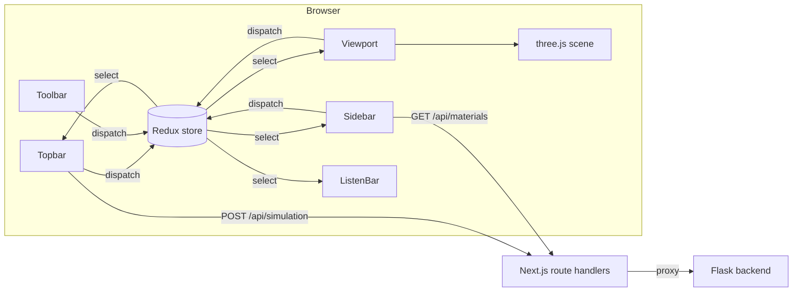
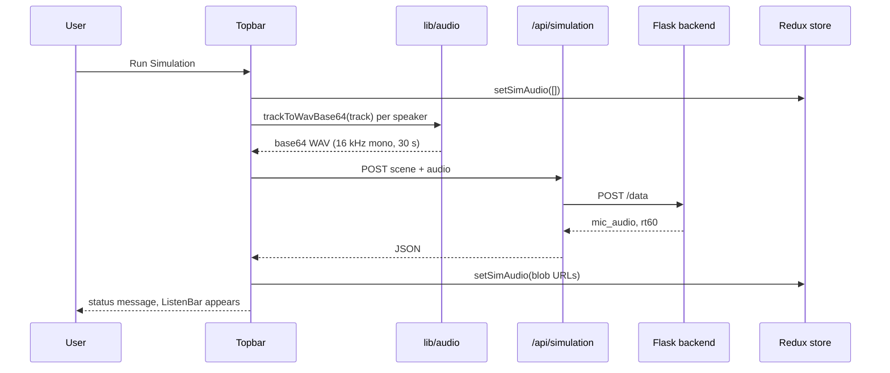

# BeamStage Frontend Documentation

The frontend is a single-page room designer built with Next.js (App Router), React, Redux Toolkit and three.js. Users lay out a room, place human speakers and mic arrays, assign audio to speakers, run the acoustic simulation on the Flask backend, and listen to the simulated recording from each mic array.

- [1. Overview](#1-overview)
- [2. Getting started](#2-getting-started)
- [3. Project structure](#3-project-structure)
- [4. Architecture](#4-architecture)
- [5. State management](#5-state-management)
- [6. Components](#6-components)
- [7. Libraries and data modules](#7-libraries-and-data-modules)
- [8. API routes and backend contract](#8-api-routes-and-backend-contract)
- [9. Key workflows](#9-key-workflows)
- [10. Simulation JSON format](#10-simulation-json-format)
- [11. Styling](#11-styling)
- [12. Conventions](#12-conventions)
- [13. Known limitations](#13-known-limitations)

---

## 1. Overview

| Concern   | Technology                                                             |
| --------- | ---------------------------------------------------------------------- |
| Framework | Next.js 16 (App Router), React 19, React Compiler enabled              |
| State     | Redux Toolkit + React-Redux                                            |
| Rendering | three.js orthographic camera on a WebGL canvas                         |
| Styling   | CSS Modules for components, Tailwind CSS 4 utilities and design tokens |
| Language  | TypeScript (strict), path alias `@/*` -> `src/*`                       |

Coordinate convention (all lengths in meters, regardless of display unit):

- `x` runs across the room, `y` is depth, `z` is height above the floor.
- three.js uses `(x, y up, z depth)`, so the scene layer maps store `(x, y, z)` to world `(x, z, y)`.

## 2. Getting started

Run from the `invisi-mic/` frontend directory:

```bash
npm install
npm run dev      # development server on http://localhost:3000
npm run build    # production build
npm run start    # serve the production build
npm run lint     # ESLint
```

The backend must be running for materials loading and simulation. Point the frontend at it with the `INVISI_MIC_API_URL` environment variable (for example in `.env.local`):

```
INVISI_MIC_API_URL=http://127.0.0.1:5000
```

If unset, the API routes default to `http://127.0.0.1:5000`. Note the backend's `main.py` may listen on a different port; the variable must match.

## 3. Project structure

```
invisi-mic/
├── next.config.ts            Next.js config (React Compiler, Tailwind via Turbopack)
├── tsconfig.json             Strict TS, `@/*` alias
├── public/audio/             Bundled speech tracks (mp3/wav)
└── src/
    ├── app/
    │   ├── layout.tsx        Root layout, fonts, global CSS, StoreProvider
    │   ├── page.tsx          Page composition (Topbar, Viewport, Toolbar, Sidebar)
    │   ├── globals.css       Tailwind import and light/dark defaults
    │   └── api/
    │       ├── simulation/route.ts   Proxy to backend `/` and `/data`
    │       └── materials/route.ts    Proxy to backend `/materials`
    ├── _components/
    │   ├── Topbar/           Presets, view/unit toggles, import/export, Run Simulation
    │   ├── Toolbar/          Vertical tool palette over the viewport
    │   ├── Sidebar/          Properties panel (room, selected node, speaker focus)
    │   ├── Viewport/         three.js canvas, interaction, ViewCube, ListenBar
    │   └── DropdownSection/  Generic collapsible section (currently unused)
    ├── store/
    │   ├── store.ts          `makeStore`, root types
    │   ├── hooks.ts          Typed `useAppDispatch` / `useAppSelector`
    │   ├── StoreProvider.tsx Client provider
    │   └── slices/           `dimensionSlice`, `sceneSlice`, `toolSlice`
    ├── lib/
    │   ├── audio.ts          Browser audio -> WAV base64 conversion
    │   └── roomShape.ts      Polygon geometry and room-drawing validation
    ├── data/
    │   ├── audioTracks.ts    Bundled track list and upload helpers
    │   └── simulationPresets.ts  Built-in venues
    └── styles/globals.css    Design tokens ("Dark Control Booth")
```

## 4. Architecture



Design notes:

- **Redux is the source of truth** for scene content, the active tool and view settings. Components read through typed selectors and write by dispatching slice actions.
- **The viewport rebuilds its three.js scene on every relevant state change** (`buildScene` / `buildDraftScene`) instead of mutating objects, and disposes the previous scene first. Only the room-drawing cursor and the unlock ring are updated in place for responsiveness.
- **Same-origin proxying**: the browser never calls the Flask server directly. Next.js route handlers forward requests, which avoids CORS and hides the backend address.
- `page.tsx` composes the layout: `Topbar` on top, then `Viewport` (with `Toolbar` overlaid) beside the `Sidebar`.

## 5. State management

The store is created per mount by `makeStore()` in [store.ts](../src/store/store.ts) with three reducers: `dimension`, `scene` and `tool`. `StoreProvider` creates the store in an effect (deferred with `setTimeout`) and renders nothing until it exists, so the UI mounts only on the client.

Use the typed hooks from [hooks.ts](../src/store/hooks.ts): `useAppDispatch` and `useAppSelector`.

### 5.1 `dimensionSlice`

| State         | Type           | Default | Purpose                                         |
| ------------- | -------------- | ------- | ----------------------------------------------- |
| `viewMode`    | `"2d" \| "3d"` | `"2d"`  | Top-down floor plan or orbitable isometric view |
| `currentUnit` | `"m" \| "ft"`  | `"m"`   | Display unit only; stored values stay in meters |

Actions: `setViewMode`, `setUnit`.

### 5.2 `sceneSlice`

Holds the room and everything placed in it.

```ts
interface Room {
  width: number
  length: number
  height: number
  outline?: { x: number; y: number }[] // polygon footprint, counter-clockwise
  tiers?: { startY: number; endY: number; elevation: number }[]
  stage?: {
    x: number
    y: number
    width: number
    length: number
    elevation: number
  }
  pillars?: { x: number; y: number; radius: number; height: number }[]
}

interface SceneItem {
  id: string
  name: string
  position: Vec3
  focusId?: string // mic arrays: speaker to aim at
  trackId?: string // speakers: audio track id
}
```

State fields:

| Field                   | Description                                                                      |
| ----------------------- | -------------------------------------------------------------------------------- |
| `room`                  | Dimensions and optional outline, tiers, stage, pillars. Initial: 14 x 10 x 4.5 m |
| `material`              | Backend wall-material key; empty until materials load                            |
| `uploads`               | User-supplied tracks (uploaded or recorded); `src` is a blob URL                 |
| `simAudio`              | Blob URLs of simulated audio, one per mic array in run order                     |
| `beamAudio`             | Blob URLs of beamformed audio keyed by the speaker id the beam points at         |
| `speakers`, `micArrays` | Placed items. Defaults: one speaker and one mic array                            |
| `selected`              | `{ kind, id }` of the selected item, or `null`                                   |
| `syncFocus`             | When true, every mic array shares one focus speaker                              |
| `counters`              | Per-kind running totals used to generate ids and names (`speaker-3`, `mic-2`)    |

Actions:

| Action                                                     | Behavior                                                                                                                                                      |
| ---------------------------------------------------------- | ------------------------------------------------------------------------------------------------------------------------------------------------------------- |
| `setRoom(partial)`                                         | Merges room fields. Resizing width or length rescales an existing outline proportionally                                                                      |
| `setRoomOutline({ outline, width, length })`               | Replaces the room with a drawn outline, drops tiers/stage/pillars, clears `simAudio`, and moves any item outside the new outline back inside via `moveInside` |
| `setMaterial`, `setUploads`, `setSimAudio`, `setBeamAudio` | Simple setters                                                                                                                                                |
| `loadSimulation(scene)`                                    | Replaces room, material, items and `syncFocus`; clears selection and `simAudio`; recomputes counters from existing ids                                        |
| `addItem({ kind, x, y })`                                  | Adds an item at its default height, selects it, and inherits the shared focus when `syncFocus` is on                                                          |
| `updateItem({ kind, id, patch })`                          | Patches an item's position                                                                                                                                    |
| `setFocus({ id, focusId })`                                | Sets one mic's focus, or all mics when `syncFocus` is on                                                                                                      |
| `setTrack({ id, trackId })`                                | Assigns or clears a speaker's audio track                                                                                                                     |
| `setSyncFocus(boolean)`                                    | Turning on copies the first mic's focus to all; turning off clears every focus                                                                                |
| `selectItem(ref \| null)`, `removeItem(ref)`               | Selection and deletion                                                                                                                                        |

Exports worth knowing:

- `DEFAULT_HEIGHT`: speakers 1.6 m, mic arrays 2.8 m.
- `focusSpeaker(mic, speakers)`: the mic's chosen speaker, or the nearest speaker (3D distance) when none is chosen. Used by the viewport (beam cones, aim readout) and the sidebar.

### 5.3 `toolSlice`

| State        | Default    | Purpose                                                                     |
| ------------ | ---------- | --------------------------------------------------------------------------- |
| `activeTool` | `"select"` | `"select" \| "mic" \| "speaker" \| "room"`                                  |
| `draft`      | `[]`       | Corners of the room outline being drawn, in meters                          |
| `gridSnap`   | `false`    | Snap placement, dragging and drawing to a grid                              |
| `unlocking`  | `false`    | Drives the short selection-ring animation when the beam lock is toggled off |
| `showBeams`  | `true`     | Show or hide mic direction cones                                            |

Actions: `setTool` (also clears `draft`), `addDraftPoint`, `popDraftPoint`, `setGridSnap`, `setUnlocking`, `setShowBeams`.

## 6. Components

### 6.1 `Topbar`

[Topbar.tsx](../src/_components/Topbar/Topbar.tsx) (client component, re-exported by `Topbar/index.tsx`).

Responsibilities:

- **API status**: on mount, `GET /api/simulation` sets `apiState` to `checking`, `connected` or `disconnected`; latency and the last run message are shown beside it.
- **Presets**: select box loads a built-in venue, switches to the 3D view and meters.
- **View and unit toggles**: dispatch `setViewMode` and `setUnit`.
- **Import / Export JSON**: see [section 10](#10-simulation-json-format).
- **Run Simulation**: `runSimulation()`, described in [section 9.1](#91-running-a-simulation). The button is disabled while running or while the API status is still `checking`.

Simulated audio blob URLs are revoked in an effect cleanup whenever `simAudio` changes.

### 6.2 `Toolbar`

[Toolbar.tsx](../src/_components/Toolbar/Toolbar.tsx): vertical palette with Select/move, Place mic array, Place speaker, Draw room, and a grid-snap toggle. Buttons expose `aria-pressed` and labels.

### 6.3 `Sidebar`

[Sidebar.tsx](../src/_components/Sidebar/Sidebar.tsx): the properties panel. Three collapsible sections:

1. **Room geometry** (collapsed by default): width, length, ceiling height (`LengthField`), mic direction cone switch, wall absorption material select, and computed room volume.
2. **Selected node** (open by default): name and kind, X/Y/Z position fields, delete button. For speakers it also shows:
   - Voice level field (local state only, not sent to the backend).
   - Audio track select, preview play/stop, **record** (microphone via `MediaRecorder`), and **upload** (MP3/WAV).
   - "Active talker (lock beam)" switch, which dispatches `setUnlocking` to animate the selection ring.
3. **Human speaker** (collapsed by default): "Sync mics" switch and focus-speaker select. With sync off, each mic targets its nearest speaker.

Helper components inside the file:

- `Field`: numeric input with a unit suffix.
- `LengthField`: converts between meters and the display unit and keeps the raw typed text while editing so partial input such as `1.` is not rewritten.
- `Metric`: bar/value display used by the currently commented-out telemetry section.

Behavior details:

- **Materials**: on mount `GET /api/materials` fills the select and the per-material absorption map, then selects the first material. Failures show "Materials unavailable".
- **Recording**: requests microphone permission, picks the first supported MIME type (`audio/webm;codecs=opus`, `audio/webm`, `audio/ogg;codecs=opus`), and on stop creates a `recording-<timestamp>` track, adds it to `uploads`, and assigns it to the speaker. Errors (unsupported browser, denied permission, empty capture) are shown inline.
- **Upload**: only `.mp3` / `.wav` accepted (`isSupportedAudio`); the file becomes an `upload-<n>` blob-URL track assigned to the speaker.
- **Cleanup**: unmount stops preview audio and any active recording stream and revokes upload blob URLs.
- **Derived values**: footprint area and perimeter come from the outline (shoelace formula) or width x length; volume is shown in the display unit cubed. RT60 (Sabine, `0.161 V / (S a)`), estimated SNR and focus score are computed but only used by the commented-out "Acoustic telemetry" section.

### 6.4 `Viewport`

[Viewport.tsx](../src/_components/Viewport/Viewport.tsx) owns the WebGL renderer and all pointer interaction.

Structure:

- One effect (dependent only on `dispatch`) creates the renderer, orthographic camera, `ResizeObserver` and pointer/wheel listeners, and tears them down on unmount.
- A second effect runs on state changes: it updates a `viewState` ref, refreshes the item height map, disposes the old scene, builds a new one and renders.
- Mutable refs (`latest`, `viewState`, `cam`, `selectedRef`) let the long-lived event handlers read current values without re-registering.

Interactions:

| Action                        | Result                                                                                                              |
| ----------------------------- | ------------------------------------------------------------------------------------------------------------------- |
| Click with Mic/Speaker tool   | Places an item on the plane at its default height (clamped to the room, inside the outline), then returns to Select |
| Click an unselected item      | Selects it                                                                                                          |
| Drag a selected item          | Moves it on a horizontal plane at its current height                                                                |
| Shift + drag an item          | Changes its height (clamped to room height)                                                                         |
| Drag empty space (3D)         | Orbits the camera                                                                                                   |
| Shift + drag empty space (3D) | Pans                                                                                                                |
| Cmd + drag (3D)               | Orbit even when over an icon                                                                                        |
| Scroll (3D)                   | Zooms (0.3x to 8x)                                                                                                  |
| Click empty space with Select | Clears selection                                                                                                    |
| Grid snap on                  | Positions snap to 0.1 / 0.25 / 0.5 / 1 m depending on room size                                                     |

Room drawing (Draw room tool): the camera switches to a fixed 40 x 30 m top-down workspace (`DRAW_ROOM`). Click adds corners; clicking the first corner or pressing Enter closes the loop; Shift locks horizontal/vertical; Backspace removes the last corner; Escape cancels. Each move validates with `canAddPoint` / `canClose` and shows a readout (wall length, closing area, or the error). A valid closed loop is normalized and dispatched as `setRoomOutline`.

Overlays: hint text for the current tool, a height/tilt/bearing readout while dragging an item (mic arrays show the angle to their focus speaker), `ViewCube` (3D only, hidden while drawing) and `ListenBar`.

### 6.5 `scene.ts`

[scene.ts](../src/_components/Viewport/scene.ts) contains pure three.js scene construction (no React).

| Export                                                        | Purpose                                                                                                                                                                                                                    |
| ------------------------------------------------------------- | -------------------------------------------------------------------------------------------------------------------------------------------------------------------------------------------------------------------------- |
| `itemName` / `parseItemName`                                  | Encode and decode `"kind:id"` names so ray picks map back to store items                                                                                                                                                   |
| `buildScene(...)`                                             | Floor, grid, tiers, stage, pillars, wall edges, dimension lines, speakers (amber spheres), mic arrays (cyan discs), stems, floor rings, selection ring, invisible hit spheres, and focus beam cones (15 degree half-angle) |
| `buildDraftScene(...)`                                        | Drawing workspace: grid, previous outline for reference, draft path, corner markers, wall length labels, rubber-band line and cursor                                                                                       |
| `updateDraftCursor(...)`                                      | Moves the rubber band and cursor without rebuilding the scene                                                                                                                                                              |
| `disposeScene(scene)`                                         | Disposes geometries and materials                                                                                                                                                                                          |
| `createCamera`, `fitCamera`, `cameraDirection`                | Orthographic camera framing for 2D (top-down) and 3D (room bounding sphere with orbit, pan, zoom)                                                                                                                          |
| `DEFAULT_CAMERA`, `MAX_ELEVATION`, `DRAW_ROOM`, `CameraState` | Camera defaults and limits                                                                                                                                                                                                 |

In 2D, higher items are drawn larger (`heightScale`) to hint at height since a top-down view has no vertical axis. Hex colors in `COLORS` mirror the CSS design tokens.

### 6.6 `ViewCube`

[ViewCube.tsx](../src/_components/Viewport/ViewCube.tsx): a CSS 3D cube that mirrors the camera orientation (`matrix3d` computed from azimuth and elevation). Clicking a face calls `onSelect(azimuth, elevation)`; the home button resets to the default isometric view.

### 6.7 `ListenBar`

[ListenBar.tsx](../src/_components/Viewport/ListenBar.tsx): appears once simulated audio exists. A select chooses which mic array's recording to play (arrays without audio are disabled); Listen/Stop plays or pauses it with an `Audio` element. The default choice follows the selected mic array.

### 6.8 `DropdownSection`

[DropdownSection.tsx](../src/_components/DropdownSection/DropdownSection.tsx): generic title + toggle section. It is not imported anywhere, and its directive reads `"use clients"` (a typo; it should be `"use client"`) so it would fail as a client component if used. The sidebar implements its own collapsible sections.

## 7. Libraries and data modules

### 7.1 `lib/roomShape.ts`

Geometry helpers for custom rooms (meters):

| Function                       | Purpose                                                                                                                                            |
| ------------------------------ | -------------------------------------------------------------------------------------------------------------------------------------------------- |
| `canAddPoint(points, next)`    | Returns an error string or `null`; rejects walls shorter than `MIN_EDGE` (0.3 m), folding back along the previous wall, and crossing earlier walls |
| `canClose(points)`             | Same checks for the closing wall, plus at least 3 corners and area of at least `MIN_AREA` (4 m^2)                                                  |
| `signedArea`, `pointInPolygon` | Shoelace area and ray-casting containment                                                                                                          |
| `normalizeOutline(points)`     | Translates to the origin, rounds to 0.01 m, makes the winding counter-clockwise (as the backend expects), returns `{ outline, width, length }`     |
| `interiorPoint(outline)`       | Midpoint of the widest horizontal span                                                                                                             |
| `moveInside(point, outline)`   | Returns the point if inside, otherwise a spot just inside the nearest wall                                                                         |
| `DRAW_AREA`                    | 40 x 30 m drawing workspace                                                                                                                        |

### 7.2 `lib/audio.ts`

- `SIM_SAMPLE_RATE = 16000` (must match `SAMPLE_RATE` in `backend/sim/sim.py`).
- `trackToWavBase64(src)`: fetches a track, decodes it with `AudioContext`, renders mono at 16 kHz through an `OfflineAudioContext` looped to a fixed 30 seconds (longer tracks are cut, shorter ones loop), and returns 16-bit PCM WAV as base64.
- `wavBase64ToUrl(encoded)`: converts base64 WAV from the backend into a blob URL for playback.

### 7.3 `data/audioTracks.ts`

- `AUDIO_TRACKS`: bundled tracks served from `public/audio` (`lecture`, `conversation`, `question`, `discussion`).
- `findTrack(id, tracks)`, `ACCEPTED_AUDIO`, `isSupportedAudio(file)` (checks extension or MIME type for MP3/WAV).

### 7.4 `data/simulationPresets.ts`

`SIMULATION_PRESETS` provides three ready-made `ImportedScene` venues:

| Preset                | Notes                                                                                          |
| --------------------- | ---------------------------------------------------------------------------------------------- |
| Lecture Hall          | Arc-shaped outline, six seating tiers, one lectern speaker, 18 mic arrays, `anechoic` material |
| Comedy Club           | Stage platform, semicircular audience, one stage speaker, five mic arrays, `brickwork`         |
| Large Conference Room | Rounded-rectangle outline, four pillars, two presenters, eight mic arrays, `hard_surface`      |

Material keys must exist in the backend's material list.

## 8. API routes and backend contract

### 8.1 Next.js route handlers

| Route             | Method | Forwards to  | Purpose                                    |
| ----------------- | ------ | ------------ | ------------------------------------------ |
| `/api/simulation` | GET    | `/`          | Health check                               |
| `/api/simulation` | POST   | `/data`      | Run a simulation (body forwarded as-is)    |
| `/api/materials`  | GET    | `/materials` | Wall materials and absorption coefficients |

Both handlers read `INVISI_MIC_API_URL` (default `http://127.0.0.1:5000`), disable caching, and return `503` with `{ "error": "Unable to reach the simulation API..." }` if the backend is unreachable or an invalid-response error when the body is not JSON.

### 8.2 `POST /api/simulation` request

Built in `runSimulation()`:

```jsonc
{
  "is_2_dimensional": false,
  "shoebox": [width, length, height],           // [width, length] in 2D
  "outline": [[x, y], ...] | null,
  "mics": [[x, y, z], ...],                     // [x, y] in 2D
  "talkers": [[x, y, z], ...],
  "material": "brickwork" | null,
  "talker_tracks": ["lecture", null, ...],      // one per talker
  "mic_focus": [0, null, ...],                  // talker index per mic
  "talker_audio": ["<base64 WAV>", null, ...]   // one per talker
}
```

The backend validates lengths, material names, and rejects `talker_audio` entries larger than 4,000,000 characters.

### 8.3 Response fields used by the frontend

| Field               | Use                                                                                                               |
| ------------------- | ----------------------------------------------------------------------------------------------------------------- |
| `mic_audio[].audio` | Base64 WAV per mic array, converted to blob URLs and stored in `simAudio`                                         |
| `beamformed[]`      | `{ talker_index, audio }`: the mic mixture beamformed (LCMV with nulls and a mask) to isolate each speaker that has audio; stored in `beamAudio` keyed by speaker id |
| `audio`             | Fallback array when `mic_audio` is absent                                                                         |
| `rt60`              | Shown in the status message                                                                                       |
| `error`             | Displayed when the status is not OK                                                                               |

### 8.4 `GET /api/materials` response

```json
{
  "materials": ["anechoic", "brickwork", "..."],
  "absorption": { "brickwork": 0.04 }
}
```

`absorption` feeds the sidebar's RT60 estimate; if a material is missing it falls back to 0.08.

## 9. Key workflows

### 9.1 Running a simulation



Speakers without a track send `null` audio. If no speaker has audio the run completes but shows "assign an audio track to hear it".

### 9.2 Adding custom audio

1. Select a speaker; in **Audio track** choose a bundled track, **upload** an MP3/WAV, or **record** with the microphone.
2. Uploaded and recorded tracks are stored in `scene.uploads` as blob URLs and assigned to that speaker.
3. On run, `trackToWavBase64` converts the blob URL like any bundled track.

Blob URLs live only in the current session; see the export limitation below.

### 9.3 Designing a custom room

1. Choose **Draw room** in the toolbar (view switches to the top-down workspace).
2. Click corners; the readout shows wall length, errors, or the closing area.
3. Close by clicking the first corner or pressing Enter.
4. `normalizeOutline` and `setRoomOutline` replace the room; items outside the outline are moved inside.

### 9.4 Focus and beams

Each mic array points its cone at `focusSpeaker(mic, speakers)`: the chosen speaker or the nearest one. `syncFocus` forces one shared target. The backend receives `mic_focus` as a speaker index per mic (`null` means no explicit focus).

## 10. Simulation JSON format

Export creates `invisi-mic-simulation-<timestamp>.json` with `format: "invisi-mic-simulation"` and `version: 1`:

```jsonc
{
  "format": "invisi-mic-simulation",
  "version": 1,
  "exportedAt": "ISO timestamp",
  "units": "meters",
  "view": "2d" | "3d",
  "room": {
    "dimensions": { "width": 0, "length": 0, "height": 0 },
    "outline": [{ "x": 0, "y": 0 }] | null,
    "tiers": [], "stage": null, "pillars": [],
    "material": "brickwork" | null
  },
  "speakers": [{ "id": "", "name": "", "position": { "x": 0, "y": 0, "z": 0 },
                 "audioTrack": { "id": "", "name": "", "source": "", "uploaded": false } | null,
                 "simulationIndex": 0 }],
  "micArrays": [{ "id": "", "name": "", "position": { "x": 0, "y": 0, "z": 0 },
                  "focusSpeakerId": "" | null, "focusSpeakerIndex": 0, "simulationIndex": 0 }],
  "settings": { "is2d": false, "sampleRate": 16000, "audioDurationSeconds": 30, "synchronizedMicFocus": false }
}
```

Import validates the structure before dispatching `loadSimulation`: format and version, positive room dimensions, outline of at least three finite points, tiers/stage/pillars within room bounds, well-formed speaker and mic lists, and unique ids. It also restores the view and resets the unit to meters. Only bundled tracks are restored; uploaded or recorded audio cannot be, so a message asks the user to select those files again.

## 11. Styling

- **Component styles**: CSS Modules next to each component (`Topbar.module.css`, `Sidebar.module.css`, `Toolbar.module.css`, `Viewport.module.css`, `ListenBar.module.css`, `ViewCube.module.css`).
- **Design tokens**: [styles/globals.css](../src/styles/globals.css) defines the dark "control booth" palette as CSS variables: surface ramps (`--color-studio-*`), text, Sonar Cyan (mic arrays, beams), Harmonic Amber (speakers), status colors, fonts and shadows.
- **Tailwind**: `app/globals.css` imports Tailwind and sets light/dark defaults; `styles/globals.css` is imported after it in `layout.tsx` and applies the dark theme (hidden overflow, non-selectable text, tabular numerals for `.font-mono`).
- **Turbopack**: `next.config.ts` routes non-module `.css` through `@tailwindcss/turbopack` and bypasses it for `*.module.css` so class exports are preserved.
- Three.js colors in `scene.ts` are hard-coded hex values that must be kept in sync with the tokens.

## 12. Conventions

- Add `"use client"` to any component using hooks, browser APIs or Redux hooks.
- Store all lengths in meters; convert only for display (`toDisplay` / `toMeters` in the sidebar, `convert` in `scene.ts`).
- Mutate state only through slice reducers; read it with `useAppSelector`.
- Keep three.js code out of React components where possible; scene construction belongs in `scene.ts`.
- Item ids follow `speaker-<n>` and `mic-<n>`; `loadSimulation` relies on this format to rebuild counters.
- Use object names of the form `kind:id` for pickable three.js meshes.
- Release blob URLs (`URL.revokeObjectURL`) when the owning state is replaced or the component unmounts.

## 13. Known limitations

- **Uploaded and recorded audio is not exported** in simulation JSON and must be re-selected after import.
- **Voice level** in the sidebar is local UI state and is not sent to the backend.
- **Acoustic telemetry** (estimated SNR, beam focus score) is computed in `Sidebar.tsx` but its section is commented out.
- **Audio length** is fixed at 30 seconds at 16 kHz; the sample rate must match the backend.
- **`DropdownSection`** is unused and contains a `"use clients"` typo.
- **Backend address**: `.env.local` may point to a specific LAN address and port; confirm it matches your backend before running.
- **Browser support**: recording requires `getUserMedia` and `MediaRecorder`; a clear message is shown otherwise.
- **Room editing**: resizing an outlined room rescales the outline, but existing tiers, stage and pillars are not rescaled.
